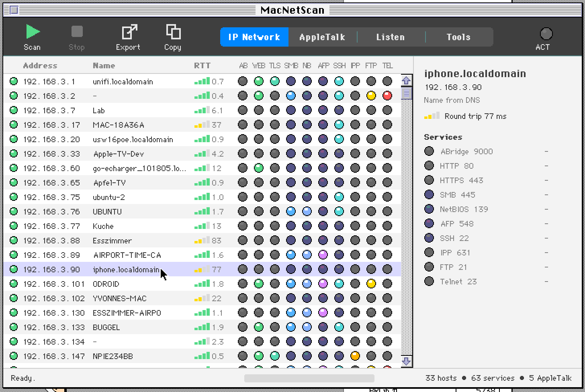
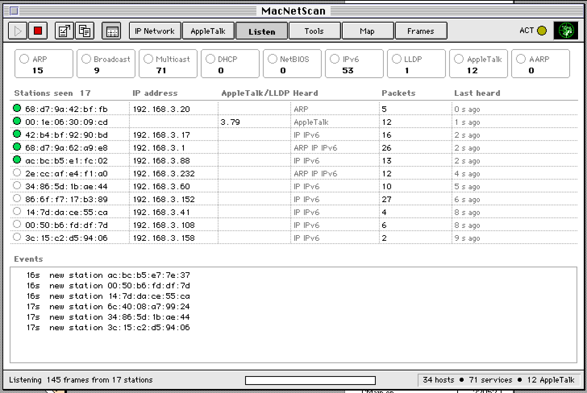
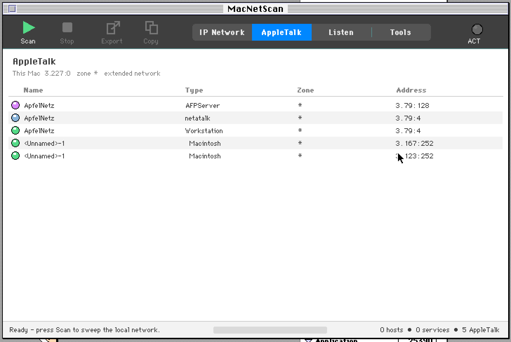
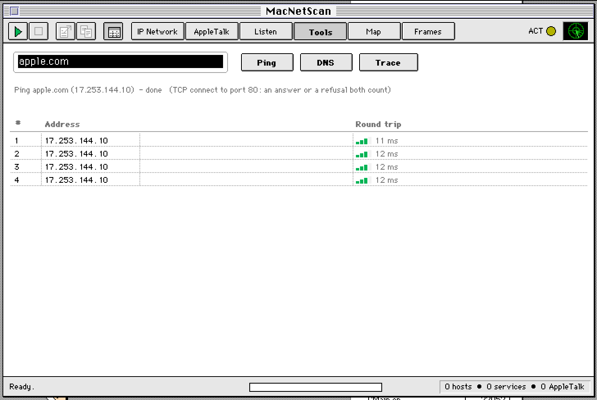

# MacNetScan 2

A network scanner for System 7 on the classic 68K Macintosh, rebuilt from [MacNetScan 1](original/) with Symantec's
**Visual Architect** and the **THINK Class Library 2.0** (Symantec C++ 7). Written, compiled, linked and tested on a
System 7.6.1 guest in Basilisk II through [AppleBridge](https://github.com/LoetLuemmel/AppleBridge).



## Views

| View | What it does |
|---|---|
| **IP Network** | Asynchronous TCP-connect sweep of the own /24 against ten well-known ports (AppleBridge, HTTP, HTTPS, SMB, NetBIOS, AFP, SSH, IPP, FTP, Telnet). Names from NetBIOS, multicast DNS or reverse DNS. Round-trip times stamped in the Open Transport notifier, to 0.1 ms. One LED per service, a detail panel per host. |
| **AppleTalk** | This Mac's node and zone; every NBP entity in every zone with a type LED and its AEP echo time; a click opens a box with what is known (an AFP server's GetStatus: machine, AFP versions, login methods, flags; the other services on that node; the volumes mounted from it). The AppleTalk traffic Listen hears, per protocol (RTMP, NBP, ATP, AEP, ZIP, ADSP, AARP: packets, bytes, sizes, share) and per sending node, a packet-size histogram. The routers on the cable from their RTMP broadcasts and the zones from ZIP: each network or range with its hops, router and zone, and the cable range Open Transport uses. The mounted volumes with their server, size and use (AFP 2.x reports at most 2 GB). Scrolled. |
| **Listen** | Passive - sends nothing but six multicast joins. ARP, IP broadcasts/multicasts (mDNS), DHCP, NetBIOS, IPv6, LLDP, AppleTalk and AARP that reach this Mac: protocol meters, a station table (MAC, IP, AppleTalk address or LLDP system name), an event log (new stations, gratuitous ARP, DHCP, IP conflicts, LLDP neighbours). |
| **Tools** | Ping (TCP connect), DNS lookup (both directions), traceroute (ICMP). |
| **Map** | Who sends to whom, from what Listen hears: the 20 busiest stations around an oval in address order, the groups they send to (broadcast, mDNS, IPv6 multicast, LLDP, AppleTalk) on an inner ring, unicast as chords; destinations never heard sending are hollow. Colour by target, width by packets (1/10/100/1000); redrawn every 2 s through a GWorld, so it does not flicker. |
| **Frames** | The capture behind Listen as a packet list - number, time, source, destination, protocol (coloured), length, a one-line summary - and below it the selected frame's protocol tree (link, ARP/AARP, IPv4/IPv6, TCP/UDP/ICMP/ICMPv6, DNS/mDNS/LLMNR, DHCP, LLDP, DDP/NBP; NetBIOS and ATP in the summary line) and its bytes in hex. The last 400 frames, 384 bytes of each. The list follows the newest frame; a click on a frame holds it still, a second click lets it follow again. Open Transport hands frames over without their MAC header, so the link layer shows the sender and the type only. **Export** writes the frames kept as a pcap file for Wireshark, link type 113 (Linux cooked capture), which needs no MAC header - just the sender and EtherType Open Transport hands on; timestamps in UTC (set the guest's Map control panel, or they are off by its time zone). |

Plus: **Export / Copy** of what the view shows, tab-delimited - the IP sweep (IP Network, Tools), the NBP entities (AppleTalk), counters, stations and events (Listen, Map), in Frames a pcap file and the selected frame as text, **Scan › Options** (range, timeout, probes at once, ports; kept in
`MacNetScan Prefs`), an About box with MacNetScan 1's radar sweep, a Finder icon.

| Listen | AppleTalk | Tools |
|---|---|---|
|  |  |  |

## Layout

```
netcore/     the engine, plain C, all Open Transport (Start / Idle / result, nothing blocks);
             frames.c the dissector behind the Frames view (reads captured frames, no OT calls)
mac/         the TCL application: CMain (window, tool strip, IP view), CViews (Listen, Tools, Map,
             Frames, About, Options), CATView (AppleTalk), CApp; Look.h shared colours and helpers; Menus.r, Extras.r, Icons.r
mac/generated/  what Visual Architect generated, for reference
mac/rsrc/    Visual Architect.rsrc and Project Resources.rsrc as MacBinary
tools/       mkicons.py (Finder icons from a PNG), patch_otlibs.py (see below), mkotnames.py (OTNames.h)
probe/       the spikes: OTProbe (engine test bench) and SniffProbe (raw Ethernet, five runs)
original/    MacNetScan 1 (MPW, one C file)
```

## Building

1. A Visual Architect project in Symantec C++ 7 (project model "Visual Architect Project"), Generate once.
   Replace `Source:CMain.*`, `CApp.*` with the files in `mac/`, add `CViews.cp`, `CATView.cp`, `Look.h`; Rez `Menus.r Extras.r
   Icons.r` into `Project Resources.rsrc` (or use the copy in `mac/rsrc/`).
2. Add `netcore/netcore.c` (it includes `otstubs.c`), `netcore/frames.c` and the four Open Transport 68K libraries through the
   ".o Converter": `OpenTransport.o`, `OpenTransportApp.o`, `OpenTptInet.o`, `OpenTptATalk.o` - **patched** with
   `tools/patch_otlibs.py` first (the SDK's `Fail` and `FlushCache` collide with TCL's). The OT SDK headers go next
   to `netcore.c`; `OTCompat.h` and `OTNames.h` (MPW's upper-case pascal names) are here.
3. Project type: **Far CODE**, partition 1500 K, creator `IPSc`. Segments: the OT libraries in one, `CViews.cp` in
   another (23.3 K of 32 K), `netcore.c` alone in a third (23.6 K), `frames.c` in a fourth (14.1 K), `CATView.cp` in a
   fifth (8.1 K) - drag each below the last segment in the project window. Nothing calls `UnloadSeg`, so the Open Transport notifiers in `netcore.c` stay resident.
4. Build Application, then `SetFile -a B MacNetScan`.

Why each step is there: the comments in `netcore/netcore.c`, `tools/patch_otlibs.py` and `probe/sniff_main.c`.

## Under Basilisk II

The Listen view binds, joins four multicast groups and receives - and that is all there is to have. Raw mode
(`I_OTSetRawMode`) and promiscuous mode (`OPT_SETPROMISCUOUS` at `LNK_TPI`) never return and freeze the guest
(flushed per-call trail in `probe/sniff_main.c`), but they would add nothing:

- With the `etherhelper` backend, `etherhelpertool` opens bpf on the host interface in promiscuous mode, unfiltered,
  with `BIOCSSEESENT` off. Basilisk's `.ENET` driver hands every frame to the handler bound for its EtherType without
  checking the destination MAC, and the guest uses the host interface's MAC - so it also sees what the host receives
  (not what the host sends).
- Open Transport does not filter unicast by destination MAC either. Proven: another host pinged a spare IP mapped to a
  made-up MAC by a static ARP entry; the switch flooded the frames and SniffProbe, binds and receives only, got every
  one.
- Raw mode would add only the destination MAC; the sender MAC comes with every frame anyway. More protocols are one
  more bind away (each bind attaches its EtherType at the driver).

**Multicast is the exception:** Open Transport drops every group nobody joined - the multicast meter stayed at 0 with
mDNS on the wire, while AppleTalk's own group arrived. `OPT_ADDMCAST` at `LNK_ENET` answers `TBADOPT`; at `LNK_TPI` it
returns `T_SUCCESS` without a hang. Listen joins mDNS (`01:00:5e:00:00:fb`), IPv6 all-nodes and mDNS
(`33:33:00:00:00:01`, `33:33:00:00:00:fb`) and LLDP (`01:80:c2:00:00:0e`) that way; the switch then shows up by name. The AppleTalk broadcast
(`09:00:07:ff:ff:ff`) is joined for DDP and AARP too - without it RTMP, NBP lookups and AARP probes of other nodes
never arrived.

**No RTMP from a lone atalkd:** netatalk's atalkd (2.2 up to today's `main`) sends RTMP data only when it has a route
from *another* interface to announce (`if (n)` after split horizon in `as_timer`). Seeded with `-router` on a single
interface it answers ZIP GetNetInfo but never announces itself, so the Macs see no router and the zone stays `*`. One
hand-made RTMP packet from the server's address makes Open Transport report "Your AppleTalk network is now available"
and the zone appear; the AppleTalk view then lists the network, its hops, router and zone.

The freeze is not in Basilisk: its `.ENET` driver answers every unknown control call with `controlErr` and completes
it (`BasiliskII/src/ether.cpp`). It is inside Open Transport's layer above that driver.

## Authorized use only

MacNetScan actively probes hosts. Use it only on networks you own or are explicitly allowed to scan.

## License

MIT - Copyright (c) 2026 Pit Förster. See [License.txt](License.txt).
